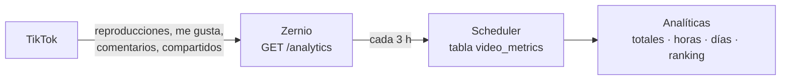

# Analíticas: qué funcionó y a qué hora

Están en **Seguimiento → Analíticas**. Zernio expone los números que TikTok da de
cada vídeo publicado. La herramienta
los guarda junto al vídeo que ya tenía en la cola, así que puede responder a las
dos preguntas que importan para programar mejor:

- **qué vídeos funcionaron**, y
- **si las horas y los días a los que estás publicando son los buenos**.

---

## Qué números hay

| Métrica                 | De dónde sale              | Cuándo aparece                            |
|-------------------------|----------------------------|-------------------------------------------|
| Reproducciones          | TikTok, vía Zernio         | a las pocas horas                         |
| Me gusta                | TikTok, vía Zernio         | a las pocas horas                         |
| Comentarios             | TikTok, vía Zernio         | a las pocas horas                         |
| Compartidos             | TikTok, vía Zernio         | a las pocas horas                         |
| % de interacción        | Zernio, o calculado aquí   | con el primer dato                        |
| Vistas de perfil        | TikTok (conexión Business) | **24–48 h** después de publicar           |
| % de vídeo visto entero | TikTok (conexión Business) | **24–48 h**, y sólo de los últimos 7 días |

El porcentaje de interacción es `(me gusta + comentarios + compartidos) /
reproducciones`. Si Zernio no lo manda, se calcula aquí con esos mismos campos,
para que un vídeo antiguo no aparezca con un 0 % que no es verdad.

Un vídeo del que TikTok todavía no ha informado (Zernio lo marca
`syncStatus: pending`) **no se guarda como ceros**: se deja para la siguiente
consulta. «Aún no medido» y «nadie lo vio» son cosas distintas, y guardar lo
primero como lo segundo hundiría las medias por hora.

## Qué números **no** hay

Nada de esto está en ninguna API pública de TikTok, ni siquiera para cuentas
Business, así que tampoco puede estar aquí:

- impresiones y alcance a nivel de cuenta,
- tiempo de visualización y tiempo medio por vídeo,
- de dónde vienen las visitas (Para ti, Siguiendo, hashtag, búsqueda, perfil),
- desglose de seguidores ganados y perdidos por vídeo.

Están en TikTok Studio y sólo ahí. La Research API de TikTok tampoco los expone
y además está limitada a uso académico no comercial.

---

## Cómo se actualiza

El worker pide los datos **cada 3 horas** (`ANALYTICS_REFRESH_MINUTES` en
`.env`; 0 lo desactiva) y mira los últimos **90 días** (`ANALYTICS_WINDOW_DAYS`;
el techo de Zernio son 366). También puedes forzarlo con **Actualizar ahora** en
la pestaña Analíticas.

Sólo se guardan los vídeos que ha publicado esta herramienta: se emparejan por
el id de post de Zernio. Lo que publiques a mano desde la app de TikTok no
aparece, porque no hay nada local con lo que compararlo.

Cada vídeo guarda **una sola fila**, que se sobrescribe en cada actualización.
Esto no es una base de datos de series temporales: para «cómo fue este vídeo»
basta el último número.

---

## Las horas y los días

La media de reproducciones se agrupa por hora de publicación y por día de la
semana, en la zona horaria de la cuenta. Tres avisos importantes:

- **Es una media, no una causa.** Un vídeo que se viraliza arrastra su hora
  entera. Por eso la lista de «tus mejores horas» ignora las horas con menos de
  **3 vídeos** detrás.
- **Necesita volumen.** Con diez vídeos publicados no hay nada que concluir.
  Los primeros meses, léelo como una curiosidad y no como una instrucción.
- **La hora de un vídeo entregado a Zernio es la que tenía programada**, con un
  margen de minutos. Zernio publica por su cuenta, puede que con la aplicación
  cerrada, y no dice a qué hora exacta lo hizo: la herramienta sólo se entera al
  volver a abrirse. Usar ese momento sería fechar toda una tanda nocturna a la
  hora del desayuno, así que se usa la hora a la que se le encargó publicar.
  Zernio retiene los vídeos que pasan del cupo de 15/día y los suelta más tarde,
  de modo que un vídeo puede haber salido algo después de lo que aquí figura.

Cuando te fíes de lo que veas, la forma de aplicarlo es la de siempre: franjas
horarias y días en **Programación**. La herramienta no reprograma nada sola.

---

## Coste y límites

Las analíticas están incluidas en todas las cuentas de Zernio, también en las
dos gratuitas. Una actualización gasta una petición por cada 100 vídeos, ocho
veces al día: nada frente a las 60 peticiones por minuto del plan gratis.

Si Zernio contesta que tu plan no cubre las analíticas (`402`), el error sale en
**Actividad** con el enlace a tu panel; el resto de la herramienta sigue igual.

---

## Fuentes

- Zernio · [Analytics API](https://docs.zernio.com/analytics/get-analytics) ·
  [TikTok](https://docs.zernio.com/platforms/tiktok) ·
  [Account insights](https://docs.zernio.com/analytics/get-tiktok-account-insights)
