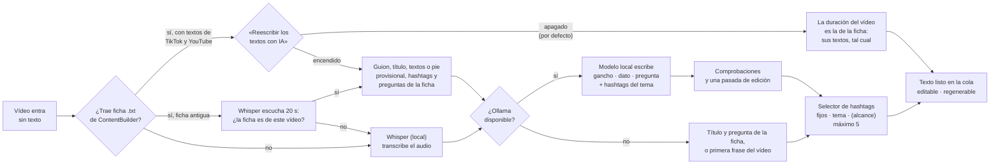

# Textos y hashtags automáticos

Un vídeo que entra **sin texto** no sale sin él. Si trae su **ficha `.txt` de
ContentBuilder** con los textos de TikTok y YouTube ya escritos, sale con ellos
tal cual, sin escucharlo ni llamar a ningún modelo (salvo que actives
**«Reescribir los textos con IA»** en la Biblioteca). Si no, la herramienta lo
escucha, escribe la descripción y elige los hashtags. Todo en tu ordenador, sin
mandar el vídeo a ningún sitio. Y lo hace **al entrar el vídeo**, no al
publicar: así lo ves, lo corriges si quieres y, si algo falla, el vídeo sigue
saliendo a su hora con lo que tenga.



---

## Qué ves en la cola

Debajo de cada vídeo pendiente hay una línea que dice por dónde va:

| Línea                                           | Significa                                                          |
|-------------------------------------------------|--------------------------------------------------------------------|
| ✍️ *Texto automático en cola…*                  | Espera su turno (se escribe uno a uno)                             |
| ● *Escuchando el vídeo y escribiendo el texto…* | Whisper (y Ollama) trabajando ahora mismo; el punto parpadea       |
| ✍️ *Texto generado · ficha .txt + Ollama*       | Listo, escrito a partir de la ficha del vídeo                      |
| ✍️ *Texto generado · Whisper + Ollama*          | Listo, escrito a partir de lo que se oye                           |
| ✍️ *Texto generado · ficha .txt*                | Los textos de la ficha (o, si es antigua, su título y su pregunta) |
| ✍️ *Texto generado · Whisper*                   | Sin Ollama: el texto es la primera frase del vídeo                 |
| ✍️ *Texto generado · sin voz: sólo hashtags*    | El vídeo no tiene voz ni ficha: sale sólo con los hashtags fijos   |
| ⚠️ *Texto automático: …*                        | Falló; el motivo va detrás. El vídeo sale con el texto que tenga   |

Detrás del origen van las notas: *ficha .txt del mismo vídeo (dura 65,0 s, como
dice la ficha)*, *ficha .txt comprobada con el audio (96 %)*, *el .txt no parece
de este vídeo…: se ignoró*, *ContentBuilder pide revisar el guion a mano: …*. Los
vídeos que siguen a la biblioteca dicen *📚 Textos de la biblioteca* y la misma
nota. En la cabecera de la cola, «✍️ 2 textos en camino» cuenta los
que faltan. Pasa el ratón por «Texto generado» y verás la transcripción (o el
guion de la ficha). Lo que el modelo quitó o añadió al pie de la ficha queda en
**Actividad**.

Botones por vídeo: **Texto** abre el editor (siguiente apartado), **Regenerar**
lo escribe de nuevo (o **Escribir solo** si el texto era tuyo y quieres uno
automático). **Lo tuyo siempre gana**: si escribes mientras se genera, lo
generado se descarta. Un vídeo ya entregado a Zernio pero **aún sin subir**
también se puede regenerar; uno que ya está en Zernio, no (recupéralo antes).

**Lo que pides a mano pasa delante.** «Regenerar» en la cola y «Reescribir» en un
vídeo suelto de la biblioteca van por un carril rápido: son lo siguiente que se
escribe, aunque haya una carpeta de cien esperando (a ~15 s el texto, eso eran
dos horas). «Reescribir textos» sobre una selección, o una carpeta que llega
entera, van por orden de llegada. La biblioteca dice cuánto le queda a la cola
de textos al ritmo de los últimos («acaban en ~2 h 15 min»).

---

## Editar los textos

**Texto** en la cola (una plataforma: la de la cuenta) y **Textos** en la
biblioteca (TikTok y YouTube en pestañas, cada una con su recuento de avisos)
abren el mismo editor. Nada se guarda hasta **Guardar** (⌘↵); cerrar con
cambios pregunta antes.

**Mientras escribes** cuenta lo que importa en cada plataforma:

| Campo             | TikTok                                            | YouTube                   |
|-------------------|---------------------------------------------------|---------------------------|
| Título            | 100 (apenas lo usa)                               | 100, obligatorio          |
| Descripción       | 2.200 **con** los hashtags que se añaden al final | 5.000                     |
| Primera línea     | ~100: es lo que se ve antes de «más»              | igual                     |
| Hashtags          | cuentan los **cinco primeros**, fijos incluidos   | etiquetas: 500 caracteres |
| Comentario fijado | 150                                               | —                         |

**La revisión** es la del generador, sobre lo que escribes tú, en tres niveles:

- ⛔ **Error** — la plataforma lo rechaza o lo corta: título de más de 100,
  descripción más larga que el máximo, YouTube sin título, letras de otro
  alfabeto.
- ⚠️ **Aviso** — conviene arreglarlo antes de que salga: arranque gastado
  («¿Sabías que…?»), primera línea de más de 100, faltan «¿» o «¡», queda un
  contador «4/50», lista de palabras con «·», palabras en inglés que el vídeo no
  dice, un hashtag en el texto y en la lista (saldría dos veces), más de cinco
  hashtags (dice cuáles no cuentan), hashtags en inglés con equivalente, campos
  `[x]` que no existen, llaves `{a|b` sin cerrar.
- 💡 **Sugerencia** — sin pregunta para comentar, menos de 3 hashtags del tema,
  `#fyp` y compañía, más de un emoji, un arranque igual que el de otro vídeo de
  la serie.

Cada línea lleva a su campo con un clic. Las marcadas **arreglable** las resuelve
**🪄 Arreglar lo automático** sin modelo y sin reescribir ninguna frase: los
«¿¡», el contador, los hashtags escritos en el texto (pasan a la lista, en su
orden), los repetidos, los no válidos, los de inglés (`#selfcare` →
`#autocuidado`) y los genéricos. Dice qué cambió.

**La vista previa** monta el post como lo monta el publicador: variantes
resueltas (siempre el mismo ejemplo, para que no baile al escribir), campos con
los valores de hoy y los hashtags fijos de Ajustes al final. En TikTok enseña lo
que se ve antes de «… más» y **qué cinco hashtags cuentan**; en YouTube, el
título y las etiquetas.

**Los hashtags son chips**: Enter, espacio o coma cierran uno (también al pegar
varios); se normalizan como en el servidor (minúsculas, tildes y ñ se quedan,
otros alfabetos no); un clic en uno lo pone el primero; los que TikTok no cuenta
salen apagados y los genéricos, tachados. Debajo, **sugerencias**: 📈 los que ya
funcionan en esa plataforma (3 o más vídeos medidos, con su media), 📁 los que
lleva la serie y 🏷️ los del banco de temas si el vídeo trata de eso.

**✨ Proponer con IA** pide a Ollama otra versión **ahora**, sin volver a escuchar
el vídeo: desde la ficha `.txt`, desde la transcripción guardada o, si el texto
es tuyo y no hay ninguna de las dos, mejorando lo que has escrito. La propuesta
se enseña aparte y se usa entera, sólo el texto o sólo los hashtags, o se
descarta. Si Ollama está escribiendo la biblioteca, espera a que acabe ese texto.

En la biblioteca, **Copiar de TikTok** (en la pestaña de YouTube) trae la
descripción, los hashtags y el comentario, y el título si no hay otro. Y los
vídeos con algo que corregir llevan **⚠ N** en la lista: el filtro **Con
avisos** deja sólo esos.

---

## Cuándo se genera y cuándo no

- Vídeo **sin texto** (subido a la biblioteca sin `.txt` al lado) → se genera a
  partir del audio, esté como esté el interruptor: no hay nada que leer.
- Vídeo con su **ficha `.txt` de ContentBuilder** y **«Reescribir los textos con
  IA» apagado** (lo normal) → no se genera nada: salen los textos de la ficha
  (siguiente apartado).
- Vídeo con su ficha e interruptor **encendido** → Ollama los escribe de nuevo a
  partir de la ficha.
- Vídeo **con texto** (escribiste algo en el formulario o hay un `.txt` que no
  es una ficha) → se usa tal cual, con sus variantes `{a|b}` y campos
  `[hashtags]`, y no se genera nada.
- `CAPTION_AI_ENABLED=false` → nunca se genera. Una ficha, aun así, no deja el
  vídeo sin texto: sale con los suyos (o, si es antigua, con su título, su
  primera pregunta y sus hashtags).

Los vídeos se escriben **de uno en uno** en un bucle aparte del que publica: una
transcripción nunca retrasa una publicación. Si a un vídeo le toca salir (o
subir a Zernio) y su texto aún no está, **espera** hasta
`CAPTION_MAX_WAIT_MINUTES` (10 por defecto) y luego sale con lo que tenga,
avisando en Actividad. Con un intervalo de 25 minutos o más entre vídeos, eso
no pasa nunca: un texto tarda segundos.

---

## La ficha `.txt` de ContentBuilder

ContentBuilder deja junto a cada `reel_07_….mp4` un `reel_07_….txt` con todo lo
que sabe del vídeo. Se reconoce por su primera línea (formato 2) o por sus
marcas (formato 1); un `.txt` sin ellas sigue siendo lo que siempre fue, un
texto escrito a mano.

**Cómo se sube.** Arrastra la carpeta con los vídeos y sus `.txt` (el mismo
nombre) a la **Biblioteca**, o cópialos juntos a `media/library/`. Un `.txt` que
llega después encuentra su vídeo en la biblioteca y le pone sus textos. Si el
vídeo acabó renombrado (`reel_07-1.mp4`), su ficha le sigue.

### Formato 2: los textos de cada plataforma, listos

Desde octubre de 2026 la ficha trae los textos **definitivos** de TikTok y de
YouTube Shorts, escritos por ContentBuilder (con el LLM externo de su plan, su
modelo local o, sin modelo, una plantilla) para el buscador y para el feed:

```
ContentBuilder · ficha de publicación · v2

· vídeo: reel_01_…_la-leche-no-les-sienta-bien.mp4
· duración: 65,0 s
· portada: El mito del platito de leche
· serie: cosas que no sabías de los gatos · 1/50
· palabra clave: leche para gatos
· textos: plan externo
· verificación: publicable

— tiktok —
· título: ¿Se le puede dar leche a un gato adulto?
· descripción:
Leche para gatos: el plato clásico que a la mayoría les sienta mal
Tras el destete fabrican muy poca lactasa, la enzima que digiere la lactosa…
¿Tu gato se vuelve loco con la leche?
· hashtags: #gatos #datoscuriosos #lactosa #michis #lechedevaca
· comentario fijado: ¿Leche sin lactosa o agua fresca: qué le das tú a tu gato cuando pide?

— youtube —
· título: ¿La leche es mala para los gatos? La culpa es de la lactasa
· descripción:
…
· hashtags: #gatos #curiosidadesdegatos #lactosa
· comentario fijado: ¿Qué otro mito sobre gatos quieres que expliquemos en el próximo vídeo?

— guion —
<lo que se oye, palabra por palabra>

— control —
· gancho: …
· idea: …
```

Con **«Reescribir los textos con IA» apagado** —el interruptor de la Biblioteca,
junto a la zona de subida; apagado por defecto—, cada plataforma recibe los
suyos tal cual: el título, la descripción, el comentario fijado y los hashtags,
con los fijos de Ajustes delante y cinco como mucho. Sin Whisper y sin Ollama:
el vídeo queda **listo** en cuanto entra («ficha .txt» en la lista), y cada cola
copia los de su plataforma. El guion queda guardado como transcripción, para la
revisión y para «✨ Proponer con IA».

**Se comprueba que es suya, gratis.** La ficha dice cuánto dura su vídeo; ffprobe
ya lo ha medido al entrar. Si no coinciden (más de 1 s o un 3 % de diferencia),
la ficha es de otro vídeo: no se usa, el vídeo queda en **«⚠ Fallidos»** con el
motivo y puedes comprobar el `.txt` o pulsar «Reescribir» para escribirlos desde
el audio. Un reel de la misma serie dura otra cosa casi siempre; un re-encode o
un rebuild con otro estilo, lo mismo.

**«📄 Textos de la ficha»**, en la barra de la Biblioteca, vuelve a poner a los
vídeos elegidos los textos de su ficha: los que se reescribieron con IA o se
editaron a mano. El interruptor vale para lo que entra a partir de ahora; para lo
que ya está, «Reescribir textos» y «Textos de la ficha».

**Con el interruptor encendido**, Ollama escribe los textos de nuevo a partir de
la ficha, como con el formato 1 (abajo), con sus textos de TikTok y YouTube como
borrador. Tampoco escucha el vídeo: la duración basta. Mientras escribe, el vídeo
lleva los de la ficha, por si le toca salir antes.

Una ficha con sólo el apartado de YouTube (los vídeos largos de PhrasesVideos)
presta sus textos a TikTok.

### Formato 1: contexto para escribir

Las fichas de antes de octubre traen el guion completo tal como se oye, la frase
de apertura, el título de la portada, un **pie de publicación provisional**
(título · palabras clave, la descripción de la serie con su «7/50» y cinco
hashtags), dos preguntas para el comentario fijado y el veredicto de su
verificador. Publicado tal cual, ese archivo pondría el guion entero en TikTok:
aquí **es contexto**, mucho mejor que una transcripción.

Con el interruptor **apagado**, de una ficha antigua salen su título, su
primera pregunta y sus hashtags (la nota lo dice: «ficha antigua…»). Para que
Ollama escriba los textos de verdad, enciéndelo antes de subirla, o pulsa
«Reescribir textos». Y para ponerle los textos nuevos de ContentBuilder sin
volver a montar el vídeo, `scripts/publicacion.py` de ContentBuilder rehace las
fichas de un lote ya hecho.

**Se comprueba que es suya** (con el interruptor encendido). El nombre dice que
van juntos; el audio lo confirma. Whisper escucha los primeros 20 s
(`CAPTION_SHEET_CHECK_SECONDS`) y las palabras tienen que seguir el guion.
Medido con tres reels de la misma serie: cada ficha con su vídeo coincide un
96–100 %, con los otros dos un 3–10 %; el umbral está en el 50 %. Escuchar 20 s
cuesta unos 3,5 s. Si no coincide, la ficha se ignora (con aviso) y el texto sale
del audio.

**Se valora el pie provisional.** El modelo recibe la ficha entera y se queda
con lo que sirve (el tema, las palabras que se buscan, los hashtags de este
vídeo), quita lo que sobra (el «7/50», la descripción larga de la serie, las
listas de palabras separadas por «·», los hashtags de otro vídeo de la serie) y
añade lo que el guion aporta (el autor, el estudio, el consejo). Anota qué ha
cambiado, y eso queda en Actividad. Un ejemplo real, el reel de las ofertas de
conexión de Gottman:

> **Antes (pie provisional)**
> Las ofertas de conexión ignoradas · apego ansioso pareja · señales de desinterés
> microcomportamientos psicológicos que delatan desinterés silencioso o
> manipulación sutil en una relación, explicados desde la psicología del apego · 2/50
> #psicologiadelapego #apegoansioso #luzdegas #chantajeemocional #banderasrojas
>
> **Después (gemma4:26b, tal cual salió)**
> Por qué las pequeñas interacciones revelan el futuro de tu relación
> John Gottman explica que las parejas estables atienden la mayoría de las
> ofertas de conexión, mientras que en las que fracasan estas peticiones caen al
> vacío.
> ¿Cuál fue la última oferta de conexión que hiciste y no recibió respuesta?
> #psicologia #relaciones #johngottman #pareja #comunicacion

`#luzdegas`, `#chantajeemocional` y `#banderasrojas` eran de otros reels de la
serie: ContentBuilder reparte los hashtags del tema por turnos, sin mirar de qué
va cada vídeo.

Si el verificador de ContentBuilder marcó el guion con **⚠ revisar a mano**, el
aviso sale en la cola y en Actividad (en amarillo) con lo que pide comprobar.
El vídeo no se para: decides tú.

---

## La descripción: gancho, dato y pregunta

TikTok enseña una línea del texto antes de «más» y lo lee como señal de
búsqueda. Un teaser de 40 caracteres («¿Cuándo pierdes la chispa con tu pareja?
🤔») no le da nada que indexar, repite lo que el vídeo ya dice en el primer
segundo y no invita a comentar. Por eso la descripción tiene tres líneas:

1. **Gancho** (40–100 caracteres): el tema con las palabras que alguien
   escribiría en el buscador, y una razón para verlo. Nunca «¿Sabías que…?»,
   «Descubre…» ni la primera frase del vídeo copiada.
2. **Dato** (60–170): algo concreto que el vídeo cuenta y aporta por sí solo —
   el hallazgo, el autor o el estudio, el consejo práctico. Nada que el vídeo
   no diga.
3. **Pregunta** (hasta 100): sobre la experiencia de quien lo ve, para que
   comente.

Los hashtags van debajo, en su propia línea.

### Comprobaciones y segunda pasada

Lo que escribe el modelo pasa unas comprobaciones, que en ContentBuilder ya
funcionaban con los guiones:

- **Lo que se arregla solo**: el «¿» y el «¡» de apertura que faltan, comillas
  que envuelven la línea, hashtags metidos en el texto, contadores de serie, un
  solo emoji en total, hashtags en inglés con equivalente claro (`#solitude` →
  `#soledad`) y los genéricos (`#fyp`, `#parati`).
- **Lo que invalida un texto**: letras de otro alfabeto (el chino que se colaba:
  `#tiempo独自`, «un error社交失误，宇宙…») y palabras en inglés («¿Lo needs?»),
  salvo las que dice el propio vídeo.
- **Lo que merece una segunda pasada**: fórmulas gastadas, líneas demasiado
  largas, falta el dato o la pregunta, menos de 3 hashtags del tema, un arranque
  igual que el de otra descripción reciente de la cuenta o, si las últimas
  empezaban todas igual («Cómo…»), otra vez lo mismo.

Si hay problemas, el modelo recibe **su propia respuesta con la lista de
problemas** y la corrige; se queda la versión con menos problemas graves (una
corrección puede empeorar un buen borrador, así que nunca gana por defecto). Si
aun así queda algo grave, se pide un borrador nuevo más conservador y, si
tampoco, el vídeo sale con el texto sin modelo y una nota que lo explica.
`CAPTION_EDITOR=false` apaga la segunda pasada.

El modelo también ve las **últimas descripciones de la cuenta** (para no abrir
cincuenta vídeos de una serie igual), el **nombre del archivo** cuando dice algo
(`reel_094_el-arte-de-estar-solo_vive-oculto-segun-epicuro` → «el arte de estar
solo · vive oculto segun epicuro») y el nombre de la cola.

---

## Whisper: la transcripción

Usa [faster-whisper](https://github.com/SYSTRAN/faster-whisper), la versión
rápida de Whisper para CPU. Los pesos se descargan **una vez** a
`data/models/whisper/` (hay un aviso en Actividad la primera vez).

| `WHISPER_MODEL` | Descarga | Medido en un Mac M2 Pro (por minuto de voz) | Cuándo             |
|-----------------|----------|---------------------------------------------|--------------------|
| `tiny`          | 75 MB    | ~2 s                                        | pruebas            |
| `base`          | 145 MB   | ~4 s                                        | voz muy clara      |
| **`small`**     | 460 MB   | **~10 s**                                   | **el por defecto** |
| `medium`        | 1,5 GB   | ~45 s                                       | acentos, ruido     |
| `large-v3`      | 3 GB     | ~1,5 min                                    | si te sobra CPU    |

Son tiempos con la CPU (`int8`); una GPU NVIDIA con `WHISPER_DEVICE=cuda` los
divide por diez. La primera vez suma la descarga y unos segundos de carga. Con
ficha, Whisper sólo escucha el principio del vídeo.

`WHISPER_LANGUAGE=es` fija el idioma (más rápido y más preciso). Vacío = lo
detecta en cada vídeo. `WHISPER_COMPUTE_TYPE=int8` es el ajuste rápido; `float32`
es algo más preciso y el doble de lento.

Whisper tiende a «oír» frases hechas en la música o el silencio (*«Subtítulos
realizados por…»*); esas se descartan. Un vídeo con menos de tres palabras de
voz cuenta como **sin voz**. Y oye mal los nombres propios poco comunes
(«Klinenberg» → «Klingenberg»): sin ficha, el modelo los hereda.

---

## Ollama: el modelo

Si hay un [Ollama](https://ollama.com) en `OLLAMA_URL` (por defecto el local,
`http://127.0.0.1:11434`), un modelo de lenguaje escribe la descripción y
propone de 3 a 5 hashtags. Se le pide la respuesta con un **esquema JSON**
(Ollama lo convierte en gramática: las claves no pueden volver cambiadas) y con
el razonamiento apagado (`think: false`): Gemma 4 y los modelos «que piensan»
gastan si no todo el presupuesto pensando y devuelven un JSON vacío, como se
vio en ContentBuilder.

**Recomendado: `gemma4:26b`.** Es una mezcla de expertos: 18 GB en memoria,
pero sólo activa una parte, así que en un Mac con Apple Silicon escribe a la
velocidad de un modelo pequeño. Medido en un M2 Pro de 32 GB con 24
transcripciones y 12 fichas reales:

| Modelo                             | s/texto (transcripción · ficha) | Textos con defectos\* | Lo que no mide la tabla                                                |
|------------------------------------|---------------------------------|-----------------------|------------------------------------------------------------------------|
| antes: `qwen2.5:7b`, sistema viejo | —                               | 24 de 24              | chino en 3, inglés en 3, hashtags fuera de tema en 17, `#fyp` en todos |
| **`gemma4:26b`**                   | **6 · 8**                       | 0                     | el español más natural; el dato trae el autor y el hallazgo            |
| `qwen2.5:14b-instruct`             | 9 · 17                          | 0                     | más plano; en una ficha dejó `#luzdegas`, que era de otro reel         |
| `qwen2.5:7b-instruct`              | 5 · —                           | 0                     | etiquetas inventadas (`#solosublime`), copia los errores de Whisper    |

\* Lo que se comprueba solo: otro alfabeto, inglés, «¿Sabías que…?», «¿» que falta,
más de un emoji, hashtags genéricos o fuera de tema. Con el sistema nuevo no pasa
ninguno, con cualquier modelo: las comprobaciones lo impiden. La diferencia entre
modelos está en cómo escriben, y eso se juzgó leyéndolos.

`OLLAMA_MODEL` vacío elige **el modelo más pequeño de 4 GB o más** que tengas,
un Gemma 4 (o Gemma 3) primero; si todos son más pequeños, el mayor. Nunca uno
de embeddings (`embeddinggemma`, `nomic-embed…`), que no sabe escribir.

**Memoria.** `OLLAMA_KEEP_ALIVE=2m`: mientras se escribe una cola, el modelo
sigue cargado (los textos van uno tras otro); dos minutos después de la última,
Ollama lo suelta. Así no se queda ocupando 18 GB mientras otra cosa —un lote de
ContentBuilder con FLUX, por ejemplo— necesita la memoria.

Sin Ollama (`OLLAMA_URL=` vacío, o no responde) el texto es la primera frase del
vídeo (limpia de «hola chicos», «eh» y similares, hasta unos 150 caracteres) o,
con ficha, su título y su primera pregunta.

Instalarlo, si no lo tienes: `brew install ollama && ollama pull gemma4:26b`.

---

## Hashtags: válidos, del tema y con audiencia

Aquí conviene ser exacto sobre lo que se puede y lo que no.

**No existe** ninguna fuente pública y sin autenticación de qué hashtags tienen
audiencia en TikTok. El *Creative Center* de TikTok, que listaba las tendencias,
responde `no permission` desde 2026 sin sesión de navegador, y raspar
`tiktok.com` es justo lo que esta herramienta no hace. Así que «aportan
audiencia» se construye con estas piezas, en este orden:

1. **Fijos**: los de Ajustes (tu marca, tu serie). Siempre primeros, nunca se
   quitan.
2. **Del tema**: los que propone Ollama a partir de la ficha o de lo que se
   dice (o las palabras más repetidas del vídeo si no hay Ollama). Si son menos
   de 3, los completa el **banco de temas** (`data/hashtags.json`), pero sólo
   con una categoría de la que el vídeo trata **de verdad**: al menos 3
   menciones de 2 palabras distintas de esa categoría.
3. **De alcance** (`#parati`, `#fyp`, `#viral`): **ninguno por defecto**
   (`HASHTAG_REACH=0`). No dicen de qué va el vídeo y cada uno ocupa un hueco
   que uno del tema aprovecha mejor.

**Máximo 5 en total**, fijos incluidos: desde agosto de 2025 TikTok sólo cuenta
los cinco primeros. `HASHTAG_MAX` puede bajarlo, no subirlo.

El umbral del banco no es un capricho. Antes bastaba una palabra dicha de pasada
para meter una categoría: en 200 textos de una serie sobre la soledad salieron
`#fitness` 39 veces, `#hogar` 26, `#receta` 22 y `#tecnologia` 18, porque un
vídeo decía «móvil», «casa», «cena» o «energía» una vez. El 87 % de las
categorías entraba así. Y «uñas», sin tilde, es «unas»: cualquier «unas
semanas» era `#belleza`. Ahora la ñ cuenta como letra propia al buscar las
palabras.

**Válidos**: se normalizan a minúsculas, se quitan espacios y símbolos, y se
descartan los de menos de 2 letras, más de 40, sólo números o con letras de
otro alfabeto (`#tiempo独自` se descarta entero: `#tiempo` sería otra etiqueta,
no la misma arreglada). Acentos, ñ, «º» y «ª» se conservan (`#españa` es una
etiqueta distinta y mayor que `#espana`), pero para no repetir, `#hábitos` y
`#habitos` cuentan como la misma.

**Con audiencia, de verdad**: la única medida real es la de **tu cuenta**. La
pestaña Analíticas ya guarda las reproducciones de cada vídeo publicado, y el
selector la usa: un hashtag que ha salido en **3 o más** vídeos se puntúa por la
media de reproducciones de esos vídeos. Los que rinden bien suben; los que
quedan por debajo de la mitad de la media de la cuenta bajan al final y se caen
de la lista cuando no hay sitio. Con pocos vídeos todo cuenta como «sin datos» y
se respeta el orden anterior: el sistema **aprende con el tiempo**, no adivina
el primer día. Lo ves en **Analíticas → Qué hashtags funcionan**.

### El banco de temas

`data/hashtags.json` trae 12 categorías (hábitos, motivación, fitness, dinero,
psicología, estudio, tecnología, cocina, humor, viajes, belleza, hogar) con las
palabras que las delatan y sus hashtags. Edítalo a mano: añade tu nicho, quita
lo que no te pegue. Se lee en cada generación, sin reiniciar. Si el archivo
falta o está roto, sólo se usan los fijos.

---

## Configuración

| Variable                      | Por defecto              | Para                                                  |
|-------------------------------|--------------------------|-------------------------------------------------------|
| `CAPTION_AI_ENABLED`          | `true`                   | Apagar todo                                           |
| `WHISPER_MODEL`               | `small`                  | Tamaño del modelo (tabla de arriba)                   |
| `WHISPER_LANGUAGE`            | `es`                     | Idioma; vacío = detectar                              |
| `WHISPER_DEVICE`              | `auto`                   | `cpu` o `cuda` si tienes GPU NVIDIA                   |
| `WHISPER_COMPUTE_TYPE`        | `int8`                   | `float32` para más precisión                          |
| `OLLAMA_URL`                  | `http://127.0.0.1:11434` | Vacío = sin Ollama                                    |
| `OLLAMA_MODEL`                | (vacío)                  | Vacío = el más pequeño de 4 GB o más, Gemma primero   |
| `OLLAMA_TIMEOUT_SECONDS`      | `120`                    | Por si el modelo es lento                             |
| `OLLAMA_KEEP_ALIVE`           | `2m`                     | Cuánto sigue cargado el modelo tras el último texto   |
| `CAPTION_EDITOR`              | `true`                   | La segunda pasada con los problemas encontrados       |
| `CAPTION_SHEET_CHECK_SECONDS` | `20`                     | Segundos que escucha Whisper para validar una ficha   |
| `HASHTAG_MAX`                 | `5`                      | Hashtags por vídeo, fijos incluidos (5 como mucho)    |
| `HASHTAG_REACH`               | `0`                      | Cuántos `#parati`/`#fyp` añadir al final si hay sitio |
| `CAPTION_MAX_WAIT_MINUTES`    | `10`                     | Cuánto espera un vídeo a su texto antes de salir      |

Nada de esto llama a internet salvo la descarga del modelo de Whisper la primera
vez (desde Hugging Face). Ollama es local. Zernio sólo recibe el texto final,
como siempre.

---

## Límites honestos

- Sin ficha, el texto sale de lo que **se dice**. Un vídeo sin voz y sin ficha
  sólo lleva los hashtags fijos: no hay nada de lo que escribir.
- Sin ficha, un nombre propio mal oído por Whisper puede acabar en el texto o en
  un hashtag. Con ficha, no: el guion es exacto.
- Whisper entiende bien el español de España y de América; con mucho ruido o
  música alta, sube a `medium`.
- La heurística sin Ollama es exactamente eso: la primera frase. Funciona
  cuando el vídeo empieza con el gancho, que es lo habitual en un reel hablado.
- Se probó a filtrar hashtags por parecido semántico con `embeddinggemma` y se
  descartó: con etiquetas de palabras pegadas no distingue (en el vídeo del
  microondas puntuaba `#desconexiondigital` en 0,07 y `#receta` en 0,20).
- Los hashtags «con audiencia» son una **hipótesis razonable que se corrige con
  tus datos**, no una consulta a TikTok. No hay forma pública de hacer esa
  consulta hoy.
