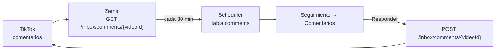

# Comentarios: leerlos y responderlos desde aquí

Zernio expone el buzón de comentarios de TikTok, así que la herramienta puede
traerse los de tus vídeos publicados, guardarlos y mandar respuestas. Está en
**Seguimiento → Comentarios** (el número de los que esperan respuesta se ve en
«Seguimiento» aunque el menú esté cerrado): no hace falta abrir la app de TikTok.

---

## Qué se puede hacer

| Acción                            | Aquí   | Notas                                                                               |
|-----------------------------------|--------|-------------------------------------------------------------------------------------|
| Leer los comentarios de un vídeo  | Sí     | Con sus respuestas (hasta 3 por comentario)                                         |
| Responder a un comentario         | Sí     | Se guarda también en local para que el hilo se lea bien                             |
| Ocultar / volver a mostrar        | Sí     | Oculto = sólo lo ve quien lo escribió                                               |
| Marcar respondido / sin responder | Sí     | Sólo en local: para lo respondido desde la app de TikTok o lo que no pide respuesta |
| Filtrar por cuenta conectada      | Sí     | Cada comentario lleva su plataforma y su cuenta, en el color de su tarjeta          |
| Dar «me gusta» a un comentario    | **No** | Zernio no lo soporta en TikTok, sólo en otras redes                                 |
| Borrar comentarios de otros       | **No** | TikTok sólo deja borrar los tuyos; para el resto, ocultar                           |
| Mensajes directos (DM)            | **No** | Ver abajo                                                                           |

---

## Requisito: la conexión tiene que ser de la app de Business

TikTok tiene **dos carriles** por los que Zernio puede haber conectado tu cuenta,
y el buzón sólo existe en uno:

- **App de TikTok for Business** — es la que usa cualquier conexión nueva. Aquí
  hay comentarios.
- **App de desarrollador** — el carril antiguo. Una cuenta conectada hace meses
  puede seguir en él, y entonces el buzón devuelve `400 PLATFORM_LIMITATION`.

Si te sale el error «esta cuenta sigue conectada por la app de desarrollador»,
entra en el panel de Zernio y **reconecta la cuenta**. No hace falta que tu
cuenta de TikTok sea de empresa: lo que importa es el carril, no el tipo de
cuenta.

> Reconectar la **misma** cuenta la conserva con su historial. Autorizar **otra**
> ocupa la plaza y borra para siempre las analíticas y el buzón de la anterior.

## Por qué se consulta en vez de recibirse

Zernio puede empujar un webhook `comment.received` en cuanto llega un
comentario, pero un webhook necesita una URL pública y esta herramienta corre en
`127.0.0.1` sin TLS. Así que pregunta, en vez de esperar:

- **cada 30 minutos** (`COMMENTS_POLL_MINUTES`), porque Zernio cachea la
  respuesta 10 minutos y preguntar más rápido devuelve lo mismo;
- sólo de los vídeos publicados en los **últimos 14 días**
  (`COMMENTS_WINDOW_DAYS`), porque después casi no llegan comentarios nuevos;
- como mucho **5 vídeos por cuenta y pasada** (`COMMENTS_BATCH`).

Con esos valores un par de cuentas gastan unas pocas decenas de peticiones al
día. Puedes apagarlo entero con `COMMENTS_ENABLED=false`, o pedirlo a mano con
**Buscar nuevos**.

Un comentario recién escrito puede tardar hasta unos 40 minutos en aparecer
(10 de caché + 30 de intervalo). Es el precio de no tener URL pública.

---

## «Sin responder»

Un comentario cuenta como pendiente si **no** es tuyo, **no** está oculto y
**no** tiene ninguna respuesta tuya colgando. El número sale en el menú
superior y en la propia pestaña.

Responder desde aquí lo marca como respondido al instante. Si respondes desde la
app de TikTok, se marcará solo en la siguiente lectura, cuando la respuesta
aparezca colgada del comentario.

Las respuestas se limitan a **150 caracteres**, que es el máximo que admite
TikTok en la app. Zernio no documenta un límite propio, así que si algún día
sube, es este número el que hay que cambiar (`CommentReplyIn` en
`app/schemas.py`).

---

## Mensajes directos: no, y no por nosotros

TikTok pone tres condiciones para que una integración use DM:

1. la cuenta tiene que ser **TikTok Business Account**;
2. su **región de registro** tiene que estar **fuera del EEE, Suiza y Reino
   Unido**;
3. sólo se puede **responder**, nunca iniciar una conversación.

Una cuenta registrada en España cae en la segunda condición, así que los DM no
están disponibles y la herramienta no los implementa.

---

## Fuentes

- Zernio · [Comentarios](https://docs.zernio.com/comments/get-inbox-post-comments) ·
  [Responder](https://docs.zernio.com/comments/reply-to-inbox-post) ·
  [Ocultar](https://docs.zernio.com/comments/hide-inbox-comment) ·
  [TikTok](https://docs.zernio.com/platforms/tiktok) ·
  [Webhooks](https://docs.zernio.com/webhooks)
