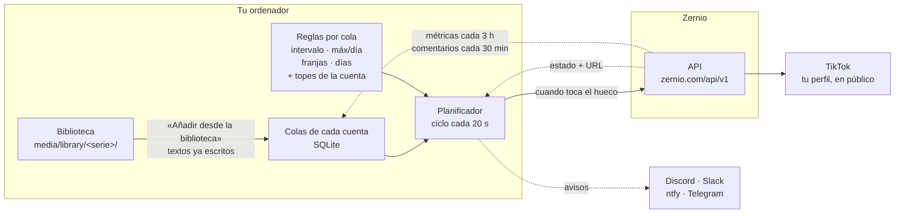
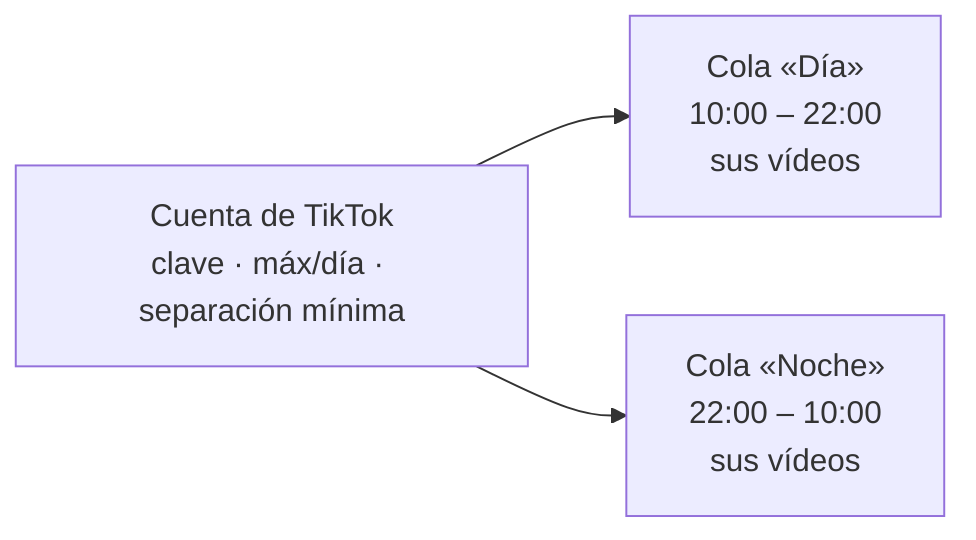
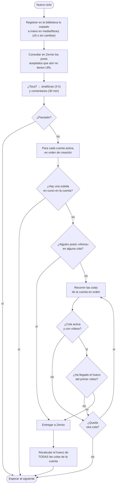
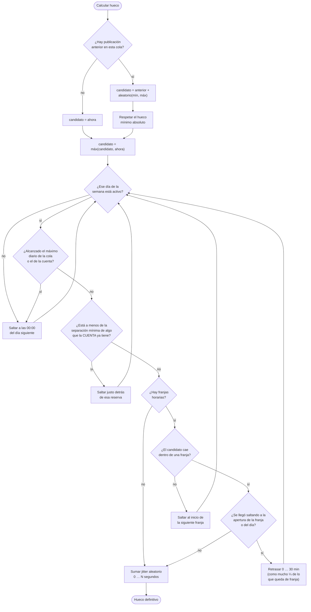
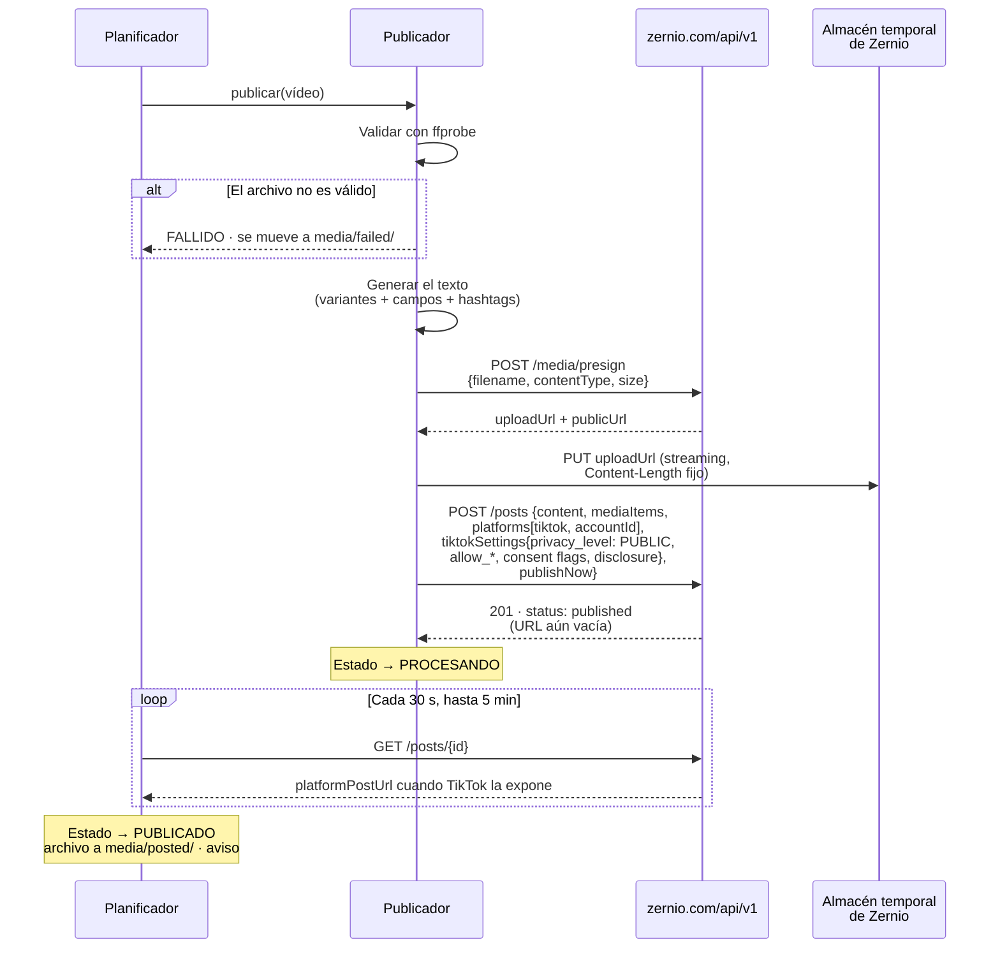
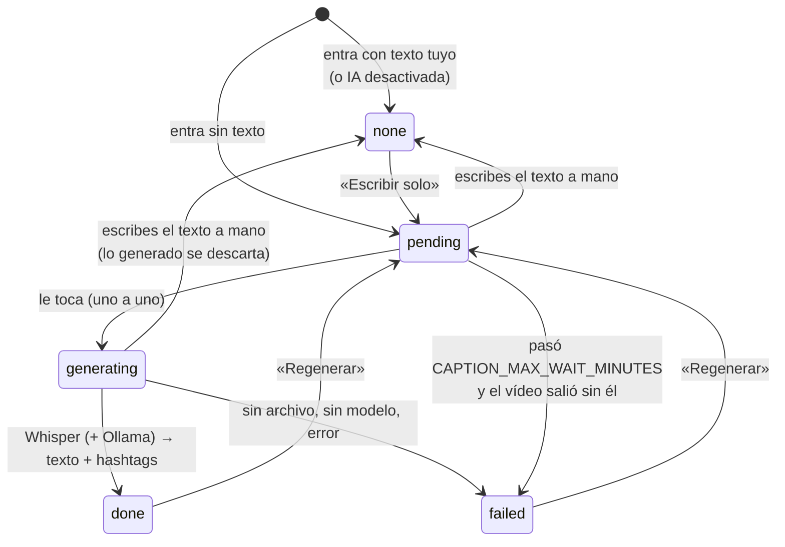
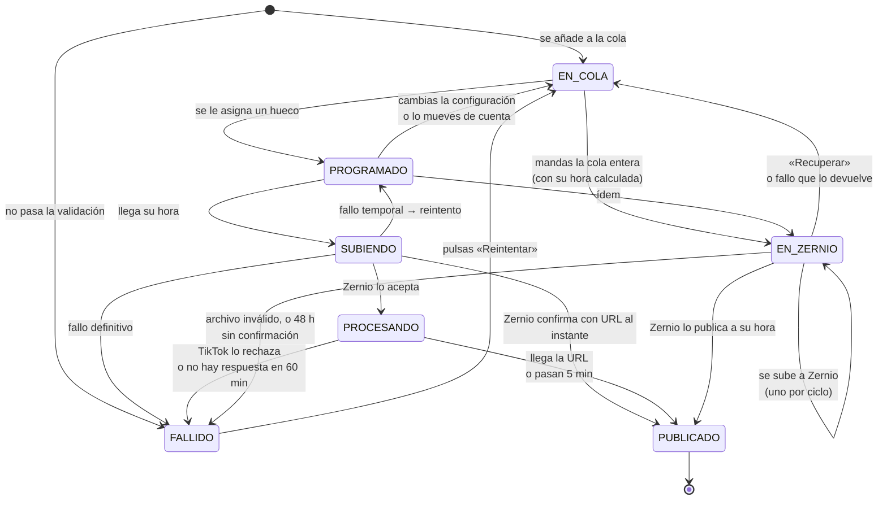
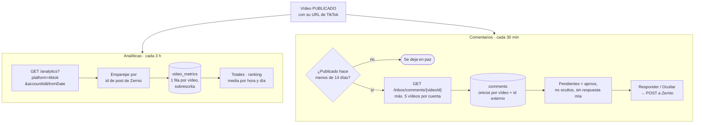
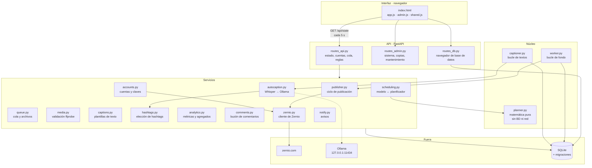

# Cómo funciona por dentro

Diagramas del recorrido completo, de un archivo en tu disco a un vídeo en TikTok.

---

## 1 · Vista general



---

## 2 · Conectar una cuenta

```mermaid
sequenceDiagram
    participant U as Tú
    participant Z as zernio.com
    participant A as Scheduler

    U->>Z: Conectas tu TikTok (OAuth en tiktok.com)<br/>y creas una API key
    U->>A: Pegas la API key
    A->>Z: GET /v1/accounts?platform=tiktok
    Z-->>A: cuentas de TikTok conectadas
    U->>A: Marcas las que quieres
    Note over A: Una fila por cuenta, con su<br/>primera cola. La key se cifra con<br/>Fernet; nunca sale por /api/state.
    A-->>U: Cuentas conectadas ✓
```

Cada cuenta se conecta **una sola vez**. Para publicarla con varios horarios se le
añaden colas (`Programación → + Nueva cola`): misma cuenta, misma clave, misma
conexión con Zernio, pero listas de vídeos y reglas independientes.



---

## 3 · El ciclo del planificador

Cada 20 segundos (configurable), en este orden:



Sólo se publica **un vídeo por ciclo y cuenta**, venga de la cola que venga: así
una subida grande no bloquea la consulta de estado del resto, y dos colas de la
misma cuenta nunca suben a la vez. Si varias colas tienen el hueco vencido sale
la del hueco **más antiguo**, no la primera de la lista. Las cuentas
**desactivadas** se saltan enteras.

Tras publicar se recalculan **todas** las colas de esa cuenta: lo que una reserva
consume presupuesto diario de la cuenta y ocupa una hora de la que las demás
tienen que mantenerse a distancia, así que las demás se mueven.

Las consultas de estado se hacen **incluso en pausa**: esas subidas ya salieron y
hay que saber cómo acabaron. Lo mismo vale para las analíticas y los comentarios:
son de sólo lectura, tienen su propio reloj y no publican nada.

---

## 4 · Cálculo del siguiente hueco

Es la parte con más lógica y la única que no puedes comprobar a ojo, por eso es
la que más tests tiene (38, incluidos los cambios de hora).



Detalles que importan:

- **El día se cuenta en tu zona horaria**, no en UTC. "6 al día" son 6 días de
  Madrid, que es lo que uno espera.
- **Las franjas que cruzan medianoche** (22:00→06:00) se tratan como un único
  tramo continuo. El contador diario se reinicia a medianoche, en mitad de la
  franja, porque el máximo es "por día natural".
- **Lo que espera a que abra una franja no sale en punto.** Si el hueco cae
  fuera de franja (o el día está lleno), el salto a la apertura añade de 0 a
  30 minutos al azar, nunca más de un cuarto de lo que queda de franja, y se
  vuelve a comprobar todo (separación, máximo diario). Así unas franjas
  7–10 y 18–22 no publican cada día a las 07:00 y a las 18:00 clavadas.
  `OPENING_SPREAD_MINUTES` en `scheduler/planner.py`.
- **El jitter siempre suma, nunca resta.** Restar podría colocar el hueco en el
  pasado o incumplir el intervalo mínimo que acabamos de aplicar.
- **Cambios de hora**: el cálculo se hace sobre instantes reales, así que nunca
  devuelve una hora imposible ni se queda en bucle.
- **La cadencia se reinicia desde cada publicación real**, también las forzadas
  con «Ahora». Un «Ahora» que falla no consume el hueco programado.
- **Las colas de una cuenta corren a la vez, no una detrás de otra.** La
  separación mínima es la distancia a las publicaciones vecinas de la cuenta, no
  un turno: una cola nueva coloca su primer vídeo hoy, entre los huecos que dejó
  la otra, aunque la otra tenga dos semanas reservadas o entregadas a Zernio.
- **Sólo hay una separación mínima y está en la cuenta.** Vale para dos vídeos
  seguidos de la misma cola y para dos vídeos de colas distintas, así que no hay
  forma de que una cola publique más apretado de lo que la cuenta permite.
- **El máximo diario de la cuenta sí es un presupuesto compartido.** Entra como
  un contador extra que suma lo de todas las colas: dos colas de 5 al día en una
  cuenta con tope 6 dan 6 publicaciones, no 10. Las últimas colas del día se
  quedan sin hueco y la interfaz lo avisa al guardar.

---

## 5 · Publicar un vídeo



---

## 5 bis · El texto, mientras el vídeo espera



El publicador mira `caption_status` antes de subir: `pending` o `generating` es
«todavía no», hasta el tope de minutos. Lo demás sale.

---

## 6 · Estados de un vídeo



**EN_ZERNIO** (`DELEGATED`) es el único estado que no depende de esta app: el
vídeo tiene hora y Zernio lo publicará aunque el ordenador esté apagado. Mientras
no tenga `zernio_post_id` es que sus bytes aún no han salido de aquí; a partir de
ahí, lo único que hace la app es preguntar por él cuando su hora ha pasado.

### Qué se reintenta y qué no

| Tipo de error  | Ejemplos                                                                          | Qué hace                                                               |
|----------------|-----------------------------------------------------------------------------------|------------------------------------------------------------------------|
| **Temporal**   | `429` de Zernio, `5xx`, caídas de red                                             | Reintenta con espera creciente (5 → 10 → 20 min, o lo que pida Zernio) |
| **Definitivo** | archivo inválido, `400`, `402` (plan), `409` (duplicado), TikTok rechaza el vídeo | No reintenta. El archivo va a `media/failed/`                          |
| **De cuenta**  | `401` (clave revocada)                                                            | No reintenta. **Cuentas → Sustituir clave**                            |

En todos los casos **el hueco programado se consume**. Si no fuese así, un vídeo
defectuoso haría que el siguiente saliese inmediatamente después, rompiendo tu
cadencia justo cuando menos te conviene.

---

## 7 · Después de publicar

Un vídeo publicado no se olvida: se le siguen pidiendo los números y los
comentarios mientras sea reciente.



El id que pide el buzón es el **id de vídeo de TikTok**, que se saca de la URL
(`/video/<id>`); si aún no hay URL, ese vídeo no se consulta. Zernio cachea la
lista de comentarios 10 minutos, así que uno nuevo puede tardar hasta unos 40
minutos en aparecer aquí.

---

## 8 · Dónde vive cada cosa



`planner.py` no importa nada de la base de datos ni de la red a propósito: así se
puede probar de forma exhaustiva sin montar nada. Ahí está toda la lógica de
"cuándo toca publicar".
