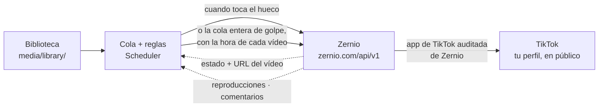

# Zernio: publicar en TikTok sin app propia

TikTok sólo deja publicar en público a las apps que han pasado su auditoría. La
auditoría exige una web pública, vídeos de demostración y una revisión manual de
días o semanas, y rechaza explícitamente las apps «de uso personal». Esta
herramienta rodea ese muro delegando la publicación en **Zernio**, un servicio
que ya tiene su propia app de TikTok auditada: conectas tu cuenta de TikTok a
Zernio una vez y, a partir de ahí, Scheduler hace la cola, la cadencia,
los textos y, cuando toca, entrega el vídeo a Zernio para que lo publique.
Después usa la misma clave para traerse las analíticas y los comentarios.

---

## Por qué Zernio y no otro

Para «TikTok + gratis + una API que esta herramienta pueda llamar», a fecha de
septiembre de 2026 sólo un servicio cumple los tres requisitos:

| Servicio                               | TikTok en el plan gratis                   | API          | Necesita tu propia app de TikTok | Precio si creces                  |
|----------------------------------------|--------------------------------------------|--------------|----------------------------------|-----------------------------------|
| **Zernio** (antes *Late*, getlate.dev) | **Sí**: 2 cuentas gratis, posts ilimitados | Sí, incluida | **No**                           | 6 $/cuenta/mes a partir de la 3.ª |
| Upload-Post                            | No: TikTok sólo en planes de pago          | Sí           | No                               | 24 $/mes                          |
| Ayrshare                               | No hay plan gratis                         | Sí           | No                               | 149 $/mes                         |
| Postiz (cloud)                         | Sólo prueba de 7 días                      | Sí           | No                               | 29 $/mes                          |
| Postiz / Mixpost autoalojados          | Gratis                                     | Sí           | **Sí** → el mismo muro           | —                                 |
| Buffer, Metricool, Publer…             | Sí                                         | **No**       | No                               | —                                 |

> Precios y límites cambian. La fuente es siempre la web de cada proveedor; este
> archivo refleja lo comprobado en septiembre de 2026.

---

## Paso a paso (10 minutos)

### 1 · Cuenta en Zernio y conectar TikTok

1. Entra en <https://zernio.com> y crea una cuenta. No pide tarjeta.
2. **Connect account → TikTok** y autoriza tu cuenta. Lo que ves es la pantalla
   de permisos de TikTok, en el dominio de TikTok: tu contraseña no pasa por
   Zernio ni por esta herramienta.
3. Repite para cada cuenta de TikTok que quieras gestionar. Zernio conecta cada
   una a través de la app de **TikTok for Business** (tu cuenta no tiene que ser
   de empresa; es el tipo de app que usa Zernio por su lado).

### 2 · API key

**Dashboard → API keys → Create**. Copia la clave. Trátala como una contraseña:
quien la tenga puede publicar en tus cuentas.

### 3 · Conectar en Scheduler

1. `make run` (o `./run.sh`) y abre <http://127.0.0.1:8787>.
2. Pega la API key y pulsa **Buscar mis cuentas de TikTok**.
3. Marca las cuentas que quieras (puedes darles un nombre) y **Conectar
   seleccionadas**. Cada una queda con su propia cola y sus reglas.

La clave se guarda **cifrada** en `data/scheduler.db` con la clave Fernet de
`.secrets/encryption.key`. Sólo viaja hacia `zernio.com`. La puedes volver a ver
en **Cuentas → Mostrar clave** (queda registrado en Actividad).

### 4 · Qué pasa al publicar

Cuando toca un hueco, la herramienta:

1. Valida el archivo con ffprobe (formato, duración, resolución, FPS).
2. Genera el texto final (variantes, campos, hashtags).
3. Pide a Zernio una URL de subida temporal y le envía el archivo en streaming
   (no carga el vídeo entero en memoria).
4. Crea el post con `publishNow: true`, privacidad **pública**, las interacciones
   y las declaraciones de contenido comercial e IA que hayas marcado.
5. Zernio publica; la herramienta consulta el estado unos minutos hasta tener la
   URL del vídeo en TikTok, mueve el archivo a `media/posted/` y te avisa por
   webhook si lo tienes configurado.
6. A partir de ahí, cada pocas horas pide las analíticas de ese vídeo y, durante
   sus primeras dos semanas, sus comentarios.

---

## Entregar la cola entera y cerrar el programa

**Cola → Mandar la cola entera a Zernio** hace lo mismo que arriba, pero para
todos los vídeos pendientes a la vez y **sin publicar ninguno**: cada post se
crea con `publishNow: false` y `scheduledFor` (más `timezone`, la de la cola),
así que Zernio lo guarda y lo publica a esa hora por su cuenta.

Las horas se calculan con el mismo planificador que usa la publicación normal:
el intervalo aleatorio de la cola, sus franjas y días, su máximo diario y el
techo de la cuenta. Antes de enviar nada se ve la lista completa con la hora de
cada vídeo y la separación entre ellos.

Después:

- Los vídeos pasan al estado **En Zernio** y dejan la rotación local, así que
  esta herramienta ya no los publicará (no hay forma de que salgan dos veces).
- La subida es **de uno en uno**, en orden de hora: hay que dejar la app abierta
  hasta que termine. Si se interrumpe, continúa al volver a arrancar.
- Una vez subidos, el ordenador puede apagarse. Cuando vuelvas a abrir la app,
  consulta el estado de los que ya tocaban y los marca como publicados, con su
  URL, sus analíticas y sus comentarios como cualquier otro. La hora de
  publicación que se guarda es la que tenían programada, no el momento en que la
  app se entera: `GET /posts/{id}` no devuelve hoy ningún `publishedAt` (sólo lo
  llevan los webhooks, que esta herramienta no usa por no tener URL pública), y
  fechar toda una tanda en el instante del sondeo falsearía las analíticas por
  hora. Si algún día la respuesta lo trae, se usa ése.
- **Recuperar de Zernio** cancela allí los que queden (`DELETE /posts/{id}`) y
  los devuelve a la cola. Sólo funciona con lo que aún no se ha publicado: nada
  puede despublicar un vídeo que ya está en TikTok.

Si la entrega supera los 15 vídeos por cuenta y 24 h, Zernio no los rechaza: los
retiene y los suelta cuando la ventana deja hueco, de modo que un vídeo puede
publicarse algo más tarde que la hora que le tocaba. La herramienta lo espera
hasta `DELEGATED_TIMEOUT_HOURS` (48 h por defecto) antes de darlo por fallido, y
sólo si Zernio, preguntado en ese momento, aún lo tiene pendiente: con la app
apagada días, lo que Zernio publicó entretanto se encuentra publicado al volver.

---

## Los dos carriles de TikTok

Zernio puede tener tu cuenta conectada por una de dos apps de TikTok, y la
diferencia importa:

|                                    | **App de TikTok for Business** | **App de desarrollador**                      |
|------------------------------------|--------------------------------|-----------------------------------------------|
| Quién la usa                       | toda conexión nueva            | conexiones antiguas, hasta que las reconectes |
| Privacidad del vídeo               | **pública y sólo pública**     | la que permita el creador                     |
| Comentarios y analíticas avanzadas | sí                             | `400 PLATFORM_LIMITATION`                     |
| Cupo compartido de publicación     | exenta                         | comparte cupo con el resto de clientes        |

Si algo del buzón falla con «esta cuenta sigue conectada por la app de
desarrollador», entra en el panel de Zernio y **reconecta la cuenta**. Reconectar
la misma conserva su historial; autorizar otra distinta ocupa la plaza y borra
las analíticas y el buzón de la anterior.

---

## Lo que tienes que saber

**Público y directo, siempre.** Es lo único que publica el carril de Business, y
desde la versión 3.0 es lo único que hace esta herramienta: no hay selector de
privacidad ni envío a borradores.

**Límites.** 15 vídeos por cuenta cada 24 h en Zernio, y 60 peticiones por
minuto en el plan gratis. Una publicación usa 3 peticiones más una consulta por
minuto hasta que aparece la URL; las analíticas gastan una cada 3 h y los
comentarios unas pocas cada media hora. Ninguno de los presets se acerca a esos
límites.

**Vídeo.** MP4, MOV o WebM, de 3 s a 10 min, hasta 4 GB, 9:16 recomendado. Son
los mismos límites que valida la herramienta antes de subir.

**Declaraciones.** «Tu marca» o «Contenido de marca» se envían como
`commercialContentType`; «Contenido generado por IA» como `video_made_with_ai`.
Esta última la lleva **cada vídeo**, no la cola: la cola sólo decide con qué
valor nace (activado por defecto) y en la cola se cambia uno a uno.

**Sonidos: no.** Ninguna API pública de TikTok deja adjuntar un sonido del
catálogo general, que es de donde salen los sonidos virales. Zernio sí expone las
pistas de la *Commercial Music Library* (`musicSoundInfo`), que es un catálogo
licenciado distinto y no da ningún empujón de alcance; esta herramienta no lo
usa. Si quieres un sonido viral, hay que ponerlo a mano en la app de TikTok.

**Qué ve Zernio.** El vídeo, el texto y la configuración del post, y —desde que
se usan analíticas y comentarios— también los números de tus vídeos y los
comentarios que recibes. Es un tercero: lee su política de privacidad antes de
darle acceso a tu cuenta. Su almacenamiento temporal guarda el archivo unos 7 días.

**Coste.** Las dos primeras cuentas conectadas son gratis para siempre (una
cuenta de TikTok = una cuenta). La tercera y siguientes, 6 $/cuenta/mes. Cada
cuenta incluye publicación, analíticas, buzón y API, sin extras.

---

## Errores que puedes ver

| En la cola o en Cuentas                         | Qué significa                                                 | Qué hacer                                                          |
|-------------------------------------------------|---------------------------------------------------------------|--------------------------------------------------------------------|
| `Zernio rechazó la API key (401)`               | Clave revocada o mal copiada                                  | **Cuentas → Sustituir clave** con una nueva de Zernio              |
| `Zernio pide una acción en tu plan (402)`       | Has superado lo que incluye tu plan                           | Entra en el panel de Zernio; el mensaje trae el enlace             |
| `Límite de peticiones de Zernio (429)`          | Demasiadas llamadas por minuto                                | Nada: se reintenta solo respetando el tiempo que pide Zernio       |
| `Zernio detectó un post duplicado (409)`        | El mismo vídeo/texto ya se publicó                            | Cambia el texto o quítalo de la cola                               |
| `sigue conectada por la app de desarrollador`   | La cuenta está en el carril antiguo: no hay buzón             | Reconéctala en el panel de Zernio                                  |
| `TikTok rejected the video`                     | TikTok no aceptó el archivo                                   | Revisa duración, resolución y códec; reconvierte a H.264 1080x1920 |
| `Estado no confirmado`                          | Se entregó pero la clave dejó de funcionar antes de confirmar | Comprueba el perfil; sustituye la clave                            |
| `esta cuenta de TikTok ya no aparece en Zernio` | Desconectaste TikTok en Zernio                                | Reconéctala en el panel de Zernio y **Probar conexión**            |

Los errores de red y los `5xx` se reintentan con espera creciente (5, 10, 20
minutos). Un `401`, un `402` o un `400` no se reintentan: no se arreglan solos.

---

## Revocar

- **En Zernio**: Dashboard → API keys → revocar. A partir de ahí los vídeos
  pendientes fallarán con un `401` claro.
- **En TikTok**: Ajustes → Seguridad → Aplicaciones conectadas → quitar Zernio.
- **Aquí**: **Cuentas → Eliminar** borra la cuenta, su clave cifrada y su cola.
  Los archivos de vídeo se quedan en `media/`.

---

## Fuentes consultadas

- Zernio · [Pricing](https://zernio.com/pricing) · [API docs](https://docs.zernio.com/) ·
  [TikTok](https://docs.zernio.com/platforms/tiktok) ·
  [Media uploads](https://docs.zernio.com/guides/media-uploads) ·
  [Rate limits](https://docs.zernio.com/guides/rate-limits) ·
  [Analytics](https://docs.zernio.com/analytics/get-analytics) ·
  [Comentarios](https://docs.zernio.com/comments/get-inbox-post-comments) ·
  [Changelog](https://docs.zernio.com/changelog)
- Upload-Post · [TikTok](https://www.upload-post.com/platforms/tiktok/)
- Ayrshare · [Pricing](https://www.ayrshare.com/pricing/)
- Postiz · [Pricing](https://postiz.com/pricing) · [TikTok provider](https://docs.postiz.com/providers/tiktok)
- TikTok · [Content Posting API](https://developers.tiktok.com/doc/content-posting-api-get-started/) ·
  [Content Sharing Guidelines](https://developers.tiktok.com/doc/content-sharing-guidelines/)
